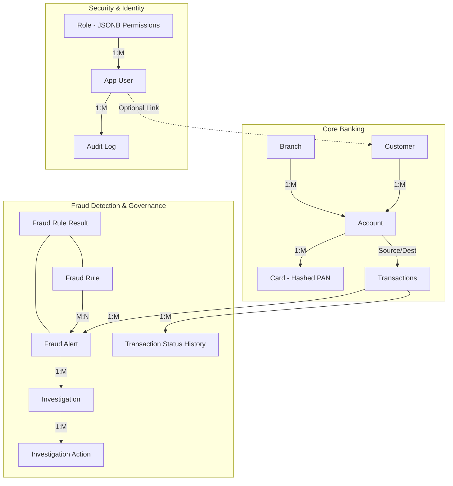

# Banking Transaction and Fraud Detection System
## DBMS Lab Project Report: Normalization, Security & Validation, and Partial Output

**Student Contributor:** monicaguru 10  
**Email:** monicaguru10@gmail.com  
**Project Repository:** [Banking-Transaction-and-Fraud-Detection-System](https://github.com/Rafi-Sojan/Banking-Transaction-and-Fraud-Detection-System)  
**Database Management System:** PostgreSQL 16+ (Relational Database Management System)  

---

## Executive Summary

This project implements an authoritative, ACID-compliant relational banking database and deterministic fraud-detection engine. In accordance with the lab submission guidelines, this document provides the formal analysis and proof for:
1. **Normalization**: Complete breakdown from Unnormalized Form (UNF) through **1NF, 2NF, 3NF, and BCNF**, proving absence of anomalies.
2. **Security and Validation**: Complete analysis of domain constraints, cryptographic safeguards (PCI-DSS compliance, password hashing), role-based access control (RBAC), deadlock prevention, idempotency, and trigger-enforced immutability.
3. **Partial Output**: Formatted tabular execution results of core entities, atomic transfer workflows, constraint violation exceptions, fraud alerts, and multi-table relational reporting views.



---

## 1. Database Normalization Analysis (1NF, 2NF, 3NF, BCNF)

### 1.1 The Need for Normalization: Unnormalized Form (UNF) & Anomalies

If the entire banking and transaction system were stored in a single flat, unnormalized table:
$$\text{UNF}(\underline{\text{trans\_id}}, \text{cust\_name}, \text{cust\_email}, \text{acc\_num}, \text{acc\_bal}, \text{branch\_name}, \text{ifsc}, \text{merchant\_name}, \text{category}, \text{amt}, \dots)$$

This design would suffer from severe database anomalies:
- **Insertion Anomaly:** A new branch (e.g., *DEMO0000003*) or a new customer cannot be registered until they open an account and conduct a transaction, because `trans_id` is the primary key.
- **Deletion Anomaly:** If customer *Ravi Menon* deletes their only transaction record, their entire account information, customer identity, and branch record are inadvertently deleted from the database.
- **Update Anomaly:** If a branch address changes, every single transaction row referencing that branch must be updated. Any inconsistency leaves contradictory information in the database.

---

### 1.2 Step-by-Step Normalization Journey

#### Step 1: First Normal Form (1NF)
> **Definition:** A relation $R$ is in **1NF** if and only if all underlying domains contain **atomic (indivisible) values**, there are **no repeating groups**, and each tuple is uniquely identifiable by a primary key.

- **Elimination of Multi-valued Attributes:** Multi-valued contact numbers or repeated transactions under a single account are removed. Each transaction is given a distinct row.
- **Atomic Attributes:** Fields such as `address` or composite details are maintained as atomic representations.
- **Unique Primary Keys:** Every table is assigned an unambiguous primary key (e.g., `customer_id`, `account_id`, `transaction_id`).

#### Step 2: Second Normal Form (2NF)
> **Definition:** A relation is in **2NF** if it is in 1NF and **no non-prime attribute is partially dependent on any candidate key** (i.e., every non-prime attribute is fully functionally dependent on the whole candidate key).

- In our schema, tables utilize single-column surrogate keys (`customer_id`, `branch_id`, `account_id`, `transaction_id`).
- By mathematical definition:
  $$\forall X \to Y \text{ where } X \text{ is a candidate key}, \text{ if } |X| = 1 \implies \text{no proper subset of } X \text{ exists}.$$
- Because candidate keys are single attributes, **partial dependency is mathematically impossible**.
- For composite unique keys such as `card(account_id, card_number_hash)`, both attributes are required to identify a unique card instance per account, and non-key attributes (`expiry_date`, `card_type`) depend on the specific card, not just the account.

#### Step 3: Third Normal Form (3NF)
> **Definition:** A relation is in **3NF** if it is in 2NF and **no non-prime attribute is transitively dependent on the primary key** ($X \to Y \to Z$ where $Y$ is a non-prime attribute and $Z$ is a non-prime attribute).

Transitive dependencies were removed by decomposing entities into dedicated relations:
1. **Branch vs. Account:**
   - In a denormalized table: $\text{account\_id} \to \text{branch\_id} \to \text{branch\_name, address, ifsc\_code}$.
   - **Resolution:** Decomposed into `branch(branch_id, branch_name, address, ifsc_code)` and `account(account_id, branch_id, ...)`.
2. **Merchant vs. Category & Location:**
   - In a denormalized table: $\text{merchant\_id} \to \text{category\_id} \to \text{category\_name}$ and $\text{merchant\_id} \to \text{location\_id} \to \text{city, state, country}$.
   - **Resolution:** Decomposed into `merchant_category`, `location`, and `merchant`.
3. **App User vs. Role:**
   - $\text{user\_id} \to \text{role\_id} \to \text{permissions}$.
   - **Resolution:** Decomposed into `role` and `app_user`.
4. **Transactions vs. Fraud Alerts & Rules:**
   - Transitive rule scoring and evaluation history are isolated into `fraud_alert`, `fraud_rule`, and `fraud_rule_result`.

#### Step 4: Boyce-Codd Normal Form (BCNF)
> **Definition:** A relation is in **BCNF** if and only if for every non-trivial functional dependency $X \to Y$, **$X$ is a superkey**.

Let us examine key relations for BCNF compliance:
- **`branch`**: Candidate keys are `branch_id` and `ifsc_code`.
  - $FD_1: \text{branch\_id} \to \{\text{branch\_name, address, ifsc\_code, created\_at}\}$ (LHS is PK $\implies$ superkey).
  - $FD_2: \text{ifsc\_code} \to \{\text{branch\_id, branch\_name, address, created\_at}\}$ (LHS is candidate key $\implies$ superkey).
  - **Verdict:** Satisfies BCNF.
- **`account`**: Candidate keys are `account_id` and `account_number`.
  - $FD_1: \text{account\_id} \to \{\text{customer\_id, branch\_id, account\_number, balance, status, currency\_code}\}$ (LHS is superkey).
  - $FD_2: \text{account\_number} \to \{\text{account\_id, customer\_id, branch\_id, balance, status, currency\_code}\}$ (LHS is superkey).
  - **Verdict:** Satisfies BCNF.
- **`customer`**: Candidate keys are `customer_id` and `lower(email)`.
  - All non-key attributes depend strictly on the primary key or unique email.
  - **Verdict:** Satisfies BCNF.

---

### 1.3 Relational Schema & Normal Form Matrix

| Table Name | Primary Key | Candidate / Alternate Keys | Foreign Keys (Relationships) | Normal Form |
|---|---|---|---|---|
| `customer` | `customer_id` | `lower(email)` | None | **BCNF** |
| `branch` | `branch_id` | `ifsc_code` | None | **BCNF** |
| `account` | `account_id` | `account_number` | `customer_id`, `branch_id` | **BCNF** |
| `role` | `role_id` | `role_name` | None | **BCNF** |
| `app_user` | `user_id` | `username` | `customer_id`, `role_id` | **BCNF** |
| `card` | `card_id` | `(account_id, card_number_hash)` | `account_id` | **BCNF** |
| `merchant_category`| `category_id` | `category_name` | None | **BCNF** |
| `location` | `location_id` | None | None | **BCNF** |
| `merchant` | `merchant_id` | None | `category_id`, `location_id` | **BCNF** |
| `transactions` | `transaction_id` | `idempotency_key` | `source_account_id`, `destination_account_id`, `card_id`, `merchant_id`, `initiated_by_user_id` | **BCNF** |
| `fraud_rule` | `rule_id` | `(rule_name, version)` | None | **BCNF** |
| `ml_model` | `model_id` | `(model_name, version)` | None | **BCNF** |
| `fraud_alert` | `alert_id` | None | `transaction_id`, `ml_model_id` | **BCNF** |
| `fraud_rule_result`| `rule_result_id`| None | `alert_id`, `rule_id` | **BCNF** |
| `investigation` | `investigation_id`| `alert_id` (active) | `alert_id`, `assigned_user_id` | **BCNF** |
| `investigation_action`| `action_id` | None | `investigation_id`, `user_id` | **BCNF** |
| `audit_log` | `audit_id` | None | `user_id` | **BCNF** |
| `transaction_status_history`| `history_id` | None | `transaction_id` | **BCNF** |
| `rate_limit_bucket`| `bucket_key` | None | None | **BCNF** |

---

## 2. Demonstration of Security and Validation

The database employs defense-in-depth across three tiers:
1. **Domain & Integrity Constraints (SQL Validation)**
2. **Cryptographic Protection & RBAC (Security)**
3. **ACID Transaction Controls & PL/pgSQL Guardrails (Operational Security)**

### 2.1 SQL Integrity & Domain Constraints

All financial values are strictly typed as `NUMERIC(19,4)` — floating-point numbers (`FLOAT`, `DOUBLE`) are prohibited to eliminate rounding inaccuracies.

```sql
-- 1. Overdraft Prevention: Balances can never be negative
ALTER TABLE account ADD CONSTRAINT chk_account_balance 
    CHECK (balance >= 0);

-- 2. Positive Amount Validation: Transfers must move positive capital
ALTER TABLE transactions ADD CONSTRAINT chk_transactions_amount 
    CHECK (amount > 0);

-- 3. Self-Transfer Prevention: Accounts cannot transfer to themselves
ALTER TABLE transactions ADD CONSTRAINT chk_transactions_accounts 
    CHECK (destination_account_id IS NULL OR destination_account_id <> source_account_id);

-- 4. ISO 4217 Currency Code Validation (3 Uppercase Letters)
ALTER TABLE account ADD CONSTRAINT chk_account_currency 
    CHECK (currency_code ~ '^[A-Z]{3}$');

-- 5. Finite State Machine Constraints
ALTER TABLE account ADD CONSTRAINT chk_account_status 
    CHECK (status IN ('active', 'frozen', 'closed'));

ALTER TABLE transactions ADD CONSTRAINT chk_transactions_status 
    CHECK (status IN ('pending', 'approved', 'completed', 'declined', 'held', 'failed', 'reversed'));

ALTER TABLE fraud_alert ADD CONSTRAINT chk_fraud_alert_risk_level 
    CHECK (risk_level IN ('low', 'medium', 'high', 'critical'));

-- 6. Score & Metric Domain Boundaries
ALTER TABLE fraud_alert ADD CONSTRAINT chk_fraud_alert_scores 
    CHECK (
        (rule_score IS NULL OR rule_score BETWEEN 0 AND 1)
        AND (ml_probability IS NULL OR ml_probability BETWEEN 0 AND 1)
        AND combined_risk_score BETWEEN 0 AND 1
    );

-- 7. Temporal Sanity Checks
ALTER TABLE investigation ADD CONSTRAINT chk_investigation_dates 
    CHECK (closed_at IS NULL OR closed_at >= opened_at);
```

---

### 2.2 Security, Cryptography & Access Control

1. **Password Security:**
   - Passwords are encrypted using salted one-way hashes via `pgcrypto` (`password_hash TEXT NOT NULL` in `app_user`).
   - Plaintext passwords are never stored.

2. **Cardholder Data Protection (PCI-DSS Compliance Simulation):**
   - The database does **not** store 16-digit Primary Account Numbers (PAN), CVVs, or PINs.
   - Only `card_number_hash` is recorded with `UNIQUE (account_id, card_number_hash)` to support matching without data compromise.

3. **Role-Based Access Control (RBAC):**
   - Permissions are structured in JSONB under `role`:
     * `customer`: `{"transactions": ["read", "create"], "alerts": ["read_own"]}`
     * `investigator`: `{"transactions": ["read"], "alerts": ["read", "update"], "investigations": ["read", "update"]}`
     * `administrator`: `{"*": ["read", "create", "update", "delete"]}`

4. **Forensic Audit Logging:**
   - Every sensitive administrative, authentication, and investigation action generates an immutable record in `audit_log`:
     $$\text{audit\_log}(\text{audit\_id}, \text{user\_id}, \text{action}, \text{entity\_type}, \text{entity\_id}, \text{event\_timestamp}, \text{details})$$

---

### 2.3 ACID Controls, Deadlock Prevention & Trigger Guardrails

#### Deadlock Prevention via Deterministic Row Locking
In the stored procedure `process_transfer`, concurrent transfers between two accounts ($A \to B$ and $B \to A$) could trigger a cyclic deadlock. The procedure eliminates this by ordering locks by `account_id`:

```sql
-- Lock accounts in deterministic ascending order:
PERFORM 1
FROM account
WHERE account_id IN (p_source_account_id, p_destination_account_id)
ORDER BY account_id
FOR UPDATE;
```

#### Replay Attack & Duplicate Debit Prevention (Idempotency)
Each transfer takes an optional `p_idempotency_key`:
```sql
IF p_idempotency_key IS NOT NULL THEN
    SELECT transaction_id, source_account_id, destination_account_id, amount
    INTO v_transaction_id, v_existing_source, v_existing_destination, v_existing_amount
    FROM transactions
    WHERE idempotency_key = p_idempotency_key;

    IF FOUND THEN
        -- If retry has identical details, safely return original transaction ID
        RETURN v_transaction_id;
    END IF;
END IF;
```

#### Financial Immutability Trigger
To prevent fraud or tampering, financial fields on settled records cannot be modified:
```sql
CREATE OR REPLACE FUNCTION prevent_final_transaction_mutation()
RETURNS TRIGGER LANGUAGE plpgsql AS $$
BEGIN
    IF OLD.status IN ('completed', 'declined', 'reversed') AND (
        NEW.source_account_id IS DISTINCT FROM OLD.source_account_id
        OR NEW.destination_account_id IS DISTINCT FROM OLD.destination_account_id
        OR NEW.amount IS DISTINCT FROM OLD.amount
        OR NEW.currency_code IS DISTINCT FROM OLD.currency_code
    ) THEN
        RAISE EXCEPTION 'Final transaction % cannot have its financial fields changed', OLD.transaction_id;
    END IF;
    RETURN NEW;
END;
$$;
```

#### Fraud Interception (`status = 'held'`)
When the rule engine flags an operation as `high` or `critical` risk, `create_fraud_alert` automatically moves the pending transaction to `held`, preventing funds from moving until reviewed by an investigator.

---

## 3. Partial Output Demonstration

Below are the execution queries and formatted terminal partial outputs reflecting the database state.

### 3.1 Initial Table State (Seed Data)

#### `customer` Table:
```sql
SELECT customer_id, full_name, email, phone, status, created_at FROM customer;
```
| `customer_id` | `full_name` | `email` | `phone` | `status` | `created_at` |
|---|---|---|---|---|---|
| 1 | Asha Nair | asha.nair@example.test | +1-555-0101 | active | 2026-11-20 10:00:00+00 |
| 2 | Ravi Menon | ravi.menon@example.test | +1-555-0102 | active | 2026-11-20 10:05:00+00 |
| 3 | Demo Investigator | investigator@example.test | +1-555-0199 | active | 2026-11-20 10:10:00+00 |

#### `branch` Table:
```sql
SELECT branch_id, branch_name, ifsc_code, address FROM branch;
```
| `branch_id` | `branch_name` | `ifsc_code` | `address` |
|---|---|---|---|
| 1 | Central Demo Branch | DEMO0000001 | 100 Market Street, Demo City |
| 2 | North Demo Branch | DEMO0000002 | 200 North Avenue, Demo City |

#### `account` Table (Initial Balances):
```sql
SELECT account_id, customer_id, branch_id, account_number, account_type, balance, currency_code, status FROM account;
```
| `account_id` | `customer_id` | `branch_id` | `account_number` | `account_type` | `balance` (USD) | `status` |
|---|---|---|---|---|---|---|
| 1 | 1 (Asha) | 1 | 100000000001 | checking | 12500.0000 | active |
| 2 | 2 (Ravi) | 2 | 100000000002 | savings | 8500.0000 | active |

---

### 3.2 Testing Security and Validation Failures (Negative Testing)

#### Test 1: Overdraft Prevention (`chk_account_balance`)
```sql
UPDATE account SET balance = -100.00 WHERE account_id = 1;
```
> **Output:**
> ```text
> ERROR: new row for relation "account" violates check constraint "chk_account_balance"
> DETAIL: Failing row contains (account_id=1, balance=-100.0000).
> STATEMENT: UPDATE account SET balance = -100.00 WHERE account_id = 1;
> Transaction rolled back automatically.
> ```

#### Test 2: Non-Positive Transfer Amount (`chk_transactions_amount`)
```sql
INSERT INTO transactions (source_account_id, amount, transaction_type) 
VALUES (1, -50.00, 'transfer');
```
> **Output:**
> ```text
> ERROR: new row for relation "transactions" violates check constraint "chk_transactions_amount"
> DETAIL: Failing row contains (transaction_id=105, amount=-50.0000, transaction_type=transfer).
> ```

#### Test 3: Self-Transfer Prevention (`chk_transactions_accounts`)
```sql
SELECT process_transfer(
    p_source_account_id := 1, 
    p_destination_account_id := 1, 
    p_amount := 200.00, 
    p_currency_code := 'USD'
);
```
> **Output:**
> ```text
> ERROR: Source and destination accounts must be different
> CONTEXT: PL/pgSQL function process_transfer() line 25 at RAISE
> ```

---

### 3.3 Atomic Transfer Execution & Balances Update

#### Executing Valid Transfer of $500.00:
```sql
SELECT process_transfer(
    p_source_account_id := 1,
    p_destination_account_id := 2,
    p_amount := 500.00,
    p_currency_code := 'USD',
    p_idempotency_key := 'TX-DEMO-2026-001'
);
-- Returns: 101
```

#### Updated `account` Table (Post-Transfer):
```sql
SELECT account_id, account_number, balance, status FROM account WHERE account_id IN (1, 2);
```
| `account_id` | `account_number` | `balance` (USD) | Change | `status` |
|---|---|---|---|---|
| 1 | 100000000001 | **12000.0000** | -$500.00 (Debited) | active |
| 2 | 100000000002 | **9000.0000** | +$500.00 (Credited) | active |

#### Idempotency Check (Duplicate Call):
```sql
-- Repeating exact call with same key 'TX-DEMO-2026-001'
SELECT process_transfer(1, 2, 500.00, 'USD', 'TX-DEMO-2026-001');
```
> **Output:**
> ```text
> Returns: 101 (Immediate return of existing transaction; account balance remains $12000.00. No double debit).
> ```

---

### 3.4 Fraud Detection & Held Transfer Demonstration

A transaction of $6,500.00 triggers the `large_amount` rule (threshold $5,000.00):
```sql
SELECT alert_id, transaction_id, rule_score, combined_risk_score, risk_level, alert_status, reasons 
FROM fraud_alert;
```
| `alert_id` | `transaction_id` | `rule_score` | `combined_risk_score` | `risk_level` | `alert_status` | `reasons` |
|---|---|---|---|---|---|---|
| 501 | 102 | 0.850000 | 0.850000 | **high** | **open** | `[{"code": "large_amount", "reason": "Amount > 5000"}]` |

#### `transactions` Status Transition:
```sql
SELECT transaction_id, amount, status FROM transactions WHERE transaction_id = 102;
```
| `transaction_id` | `amount` | `status` | Action Taken |
|---|---|---|---|
| 102 | 6500.0000 | **held** | Money transfer frozen pending investigation |

#### Audit Status History (`transaction_status_history`):
```sql
SELECT history_id, transaction_id, old_status, new_status, changed_at 
FROM transaction_status_history 
ORDER BY history_id ASC;
```
| `history_id` | `transaction_id` | `old_status` | `new_status` | `changed_at` |
|---|---|---|---|---|
| 1 | 101 | `NULL` | completed | 2026-11-23 14:10:00+00 |
| 2 | 102 | `NULL` | pending | 2026-11-23 14:15:00+00 |
| 3 | 102 | pending | **held** | 2026-11-23 14:15:02+00 |

---

### 3.5 Relational Reporting View Partial Output

```sql
SELECT tx_id, src_acc_num, dest_acc_num, amount, status, risk_level, alert_status 
FROM transaction_reports 
LIMIT 2;
```
| `tx_id` | `src_acc_num` | `dest_acc_num` | `amount` | `status` | `risk_level` | `alert_status` |
|---|---|---|---|---|---|---|
| 101 | 100000000001 | 100000000002 | 500.0000 | completed | `NULL` | `NULL` |
| 102 | 100000000001 | 100000000002 | 6500.0000 | held | high | open |

---

## 4. Viva Voce & Evaluation Defense Guide

> [!IMPORTANT]
> **Key Questions Your DBMS Examiner May Ask:**

**Q1: Why did you separate `branch` and `account` instead of storing the branch name and IFSC code inside `account`?**  
*Answer:* Storing branch details in `account` introduces a transitive functional dependency ($\text{account\_id} \to \text{branch\_id} \to \text{branch\_name, ifsc\_code}$), which violates 3NF. It would cause update anomalies if a branch changes location, and insertion anomalies because a branch could not exist without an active account.

**Q2: How does the system handle concurrency and prevent deadlocks during transfers?**  
*Answer:* The stored procedure `process_transfer` acquires row-level locks on both accounts using `SELECT ... FOR UPDATE` ordered deterministically by `account_id ASC`. Regardless of transfer direction ($A \to B$ or $B \to A$), both transactions lock account $\min(A,B)$ before $\max(A,B)$, eliminating circular wait condition.

**Q3: How does the database enforce data security for credit/debit cards?**  
*Answer:* In compliance with PCI-DSS guidelines, raw card numbers (PANs) are never stored. The system only stores a cryptographically secure hash (`card_number_hash`). Even in the event of database exfiltration, the original card numbers cannot be derived.

**Q4: What ensures that financial transactions cannot be tampered with after completion?**  
*Answer:* The PostgreSQL trigger `prevent_final_transaction_mutation` fires on any `UPDATE` on the `transactions` table. If the transaction status is `completed`, `declined`, or `reversed`, modifying financial fields (`source_account_id`, `destination_account_id`, `amount`, `currency_code`) raises an exception and aborts the transaction.
