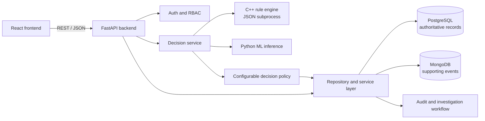
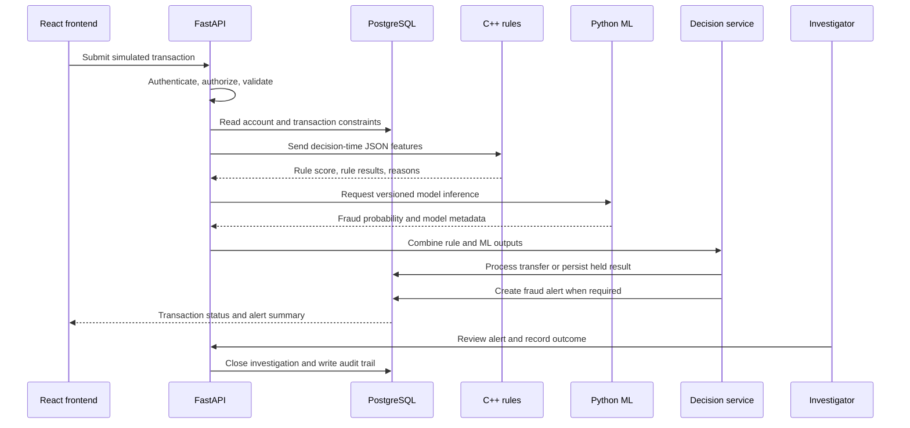
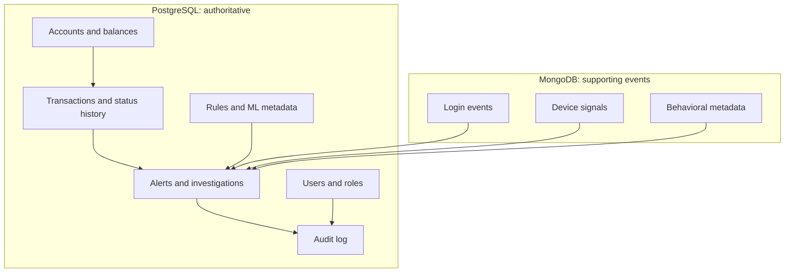

# System Architecture

Last updated: 2026-10-21

The Banking Transaction and Fraud Detection System is an academic simulation of
banking operations and fraud analysis. It uses a modular architecture so that
financial persistence, deterministic rules, machine learning, and presentation
remain separate responsibilities.

The architecture is designed for simulated data only. It must not connect to
real bank accounts, process real payments, or claim production-grade fraud
detection.

## Implementation status

| Component | Technology | Current state |
|---|---|---|
| User interface | React and Vite | Scaffolding exists; end-to-end integration is pending. |
| Application API | Python and FastAPI | Core API, auth, services, PostgreSQL workflow, MongoDB event adapter, and C++ adapter implemented. |
| Authoritative data | PostgreSQL | Schema, routines, views, seed data, and integration tests implemented. |
| Supporting events | MongoDB | Optional event-write adapter implemented; event queries remain out of scope. |
| Deterministic fraud rules | C++17 | Library, executable, JSON contract, and unit tests implemented. |
| ML inference | Python, scikit-learn, Joblib | Planned; training and inference pipeline is pending. |
| CI | GitHub Actions | C++ build, unit-test, and JSON smoke-test workflow implemented. |

## Component boundaries

### React frontend

The frontend is responsible for presentation and user interaction:

- Customer dashboard and transaction history.
- Transaction submission and status display.
- Fraud-alert listing and details.
- Investigator review and action entry.
- Reusable components and a dedicated API service layer.

It must not contain database credentials, authoritative fraud logic, account
balance arithmetic, or ML inference code.

### FastAPI backend

FastAPI is the application coordinator. It is responsible for:

- Authentication and role-based authorization.
- Pydantic request and response validation.
- Repository/service orchestration.
- Collecting permitted decision-time features.
- Invoking the C++ rule engine through its controlled JSON subprocess contract.
- Invoking the Python ML inference component.
- Combining rule and ML scores using a documented policy.
- Calling PostgreSQL routines and persisting alerts, investigations, and audit records.
- Error handling, logging, configuration, and response serialization.

Route handlers should remain thin; business logic belongs in services and data
access belongs in repositories.

### PostgreSQL

PostgreSQL is the source of truth for:

- Customers, accounts, branches, cards, merchants, and locations.
- Transactions, balances, and transaction status history.
- Fraud alerts, rule results, investigations, and actions.
- Users, roles, fraud-rule configuration, ML-model metadata, and audit logs.

Balance changes must use the atomic `process_transfer` database function. The
database enforces foreign keys, constraints, idempotency, status transitions,
and finalized-transaction protection.

### MongoDB

MongoDB is reserved for flexible supporting events such as:

- Login events.
- Device fingerprints.
- Simulated behavioral events.
- Event metadata used as fraud features.

MongoDB must not store authoritative balances, ledger records, or replacement
copies of PostgreSQL transactions.

### C++ rule engine

The C++ engine evaluates deterministic, explainable rules. It accepts one JSON
object on stdin and returns one JSON object on stdout. It returns rule IDs,
reasons, risk contributions, a normalized rule score, and a risk level.

It does not access databases, invoke ML, change balances, confirm fraud, or make
the final transaction authorization decision.

### Python ML component

The ML component will own:

- PaySim preprocessing and feature engineering.
- Reproducible training and evaluation.
- Model and preprocessing-pipeline persistence.
- Versioned inference.
- Metrics and model metadata.

The model must use only decision-time features, exclude labels and leakage
fields, and report fraud-class metrics separately from overall accuracy.

## System architecture diagram

The source for this diagram is
[system-architecture.mmd](diagrams/system-architecture.mmd).

Solid ownership boundaries are intentional: PostgreSQL owns financial truth,
MongoDB owns supporting events, C++ owns deterministic rule evaluation, and
Python owns model inference.

## Transaction and fraud workflow

The source for this sequence diagram is
[transaction-fraud-workflow.mmd](diagrams/transaction-fraud-workflow.mmd).

Fraud risk is separate from the final simulated transaction decision. A high
or critical alert may hold a pending transaction, but an alert is not proof of
fraud. Investigation outcomes remain distinct from model predictions.

## Data ownership diagram

The source for this diagram is [data-ownership.mmd](diagrams/data-ownership.mmd).

MongoDB signals can support scoring, but PostgreSQL remains authoritative when
there is a conflict about account, balance, or transaction state.

## ER diagram conventions

The conceptual ER source is
[er-architecture.dot](diagrams/er-architecture.dot). It uses classical Chen
notation:

- Rectangles represent entities.
- Ovals represent attributes.
- Diamonds represent named relationships.
- Primary-key attributes are marked with an `PK` label in the source.
- Relationship edges use `1`, `M`, or `0..1` labels where optionality matters.

The relational schema adds `transaction_status_history` and
`fraud_rule_result` because state history and rule-level explainability are
required by the implementation even though they are supporting entities in the
conceptual model.

## Deployment and local development

Local orchestration is described in `docker-compose.yaml`:

- PostgreSQL exposes port `5432`.
- MongoDB exposes port `27017`.
- Named volumes preserve local database state.

The PostgreSQL schema is initialized separately with
`database/setup.sql`. The C++ engine is built using CMake and can be invoked as
a local executable or controlled FastAPI subprocess.

## Failure behavior

- Invalid API input is rejected before fraud evaluation.
- C++ malformed input returns a non-zero exit code and writes an error to stderr.
- PostgreSQL rejects invalid amounts, currencies, statuses, relationships, and
  duplicate idempotency keys.
- A failed or unavailable fraud component must be handled explicitly by the
  backend decision service; it must not silently be treated as a successful
  low-risk result.
- Database transaction boundaries must preserve consistent account and alert
  state.

## Security boundaries

- Secrets belong in environment variables; `.env.example` contains placeholders only.
- Passwords are stored as hashes, never plaintext.
- Raw card numbers are not stored; the schema uses card-number hashes.
- Backend authorization is mandatory even when frontend controls hide actions.
- C++ subprocess input must be passed without shell-string interpolation.
- Logs must not contain passwords, tokens, or unnecessary sensitive data.

## Related documentation

- [Database design](database-design.md)
- [Function reference](function-reference.md)
- [Implementation status](implementation-status.md)
- [Database documentation](../database/README.md)
- [C++ engine documentation](../cpp/README.md)
